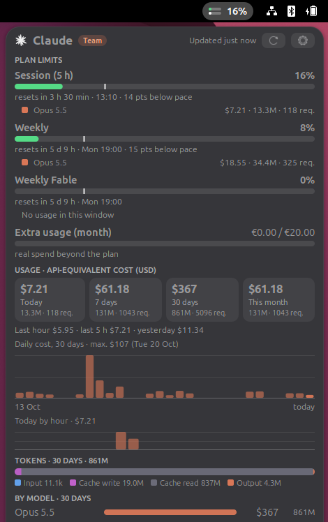

# Claude Usage — GNOME Shell extension

Unofficial top-bar indicator for your **Claude subscription limits** and the **API-equivalent cost** of
your **Claude Code** usage.



- **Plan limits**: 5-hour session, weekly, per-model weekly (e.g. Fable) and extra usage, with a pace
  marker showing how far into each window you are.
- **Per-model breakdown inside each limit window**: cost, tokens and requests per model in the current
  session/week, plus an estimated share of the limit (`≈%`) when several models were used.
- **Spend at API prices** from Claude Code's local logs: today / 7 days / 30 days / this month, daily and
  hourly charts, tokens by type, by model and by project.
- The menu opens on hover and stays open on click. Preferences: show/hide the percentage in the top bar,
  automatic price table updates.
- English and Spanish.

## Requirements

- GNOME Shell 50
- `python3` (standard library only)
- [Claude Code](https://claude.com/claude-code) signed in with a Claude subscription

## How it works

`helper/claude-usage.py` is launched asynchronously every few minutes:

1. **Limits** — `GET https://api.anthropic.com/api/oauth/usage` using the OAuth token Claude Code stores in
   `~/.claude/.credentials.json`. The token is only *read*; it is never refreshed or sent anywhere else.
   When it expires, the extension shows the last saved data until you open `claude` again.
   This is the endpoint Claude Code itself uses; it is not a documented public API and may change.
2. **Spend** — Claude Code's JSONL logs in `~/.claude/projects/` are parsed incrementally and priced with
   `src/helper/pricing.json`. This is an *API-equivalent* figure, not what your subscription costs.

Nothing else leaves your machine: besides `api.anthropic.com`, the helper only downloads
`pricing.json` from this repository, at most once a day (can be turned off in the preferences).
Cached data lives in `~/.cache/claude-usage-bar/`.

## Prices

`src/helper/pricing.json` is generated from the Markdown version of Anthropic's
[pricing page](https://platform.claude.com/docs/en/about-claude/pricing) (first-party API table,
long-context rates, fast mode, US-only inference multiplier) by `tools/update_pricing.py`, which
validates the result before writing it. The [Update pricing](.github/workflows/update-pricing.yml)
workflow runs it every Monday and commits any change, so new models and price changes reach installed
extensions within a day without a new release. The bundled copy is used offline or when updates are
disabled.

```sh
python3 tools/update_pricing.py           # refresh locally
python3 tools/update_pricing.py --check   # exit 1 if out of date
```

The helper also works on its own:

```sh
python3 src/helper/claude-usage.py --summary
```

## Install from source

```sh
./build.sh --install
# Wayland: log out and back in, then
gnome-extensions enable claude-usage@fredycibersec
```

## Translations

```sh
python3 tools/i18n.py extract   # refresh po/claude-usage.pot
# copy it to po/<lang>.po and translate
python3 tools/i18n.py check     # msgids missing from each .po
```

## License

GPL-2.0-or-later. Not affiliated with or endorsed by Anthropic. "Claude" is a trademark of Anthropic, PBC.
